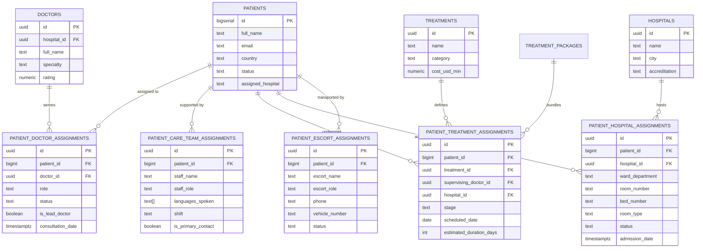

# HealWithIndia: Relational Patient Assignment Architecture & Schema Specification

## 1. Executive Summary & Objective

In medical tourism operations, international patients traveling abroad require complex multi-disciplinary coordination. A single patient record in isolation is insufficient; the platform must maintain strictly validated relational connections to:
1. **Accredited Physicians & Lead Surgeons** (`patient_doctor_assignments`)
2. **Multidisciplinary Support Teams & Language Interpreters** (`patient_care_team_assignments`)
3. **Scheduled Surgical Procedures & Treatment Milestones** (`patient_treatment_assignments`)
4. **Partner Hospital Inpatient Wards & Bed Allocations** (`patient_hospital_assignments`)
5. **Logistics, Chauffeurs & Airport Escorts** (`patient_escort_assignments`)

This document details the relational database architecture, entity relationships, security policies (Row Level Security), backend service abstractions, and user interface components engineered to support these linkages.

---

## 2. Entity-Relationship Diagram (ERD)

---

## 3. Relational Schema Definitions

### 3.1 Patient-Doctor Assignments (`patient_doctor_assignments`)
- **Primary Key**: `id UUID DEFAULT uuid_generate_v4()`
- **Foreign Keys**:
  - `patient_id BIGINT REFERENCES patients(id) ON DELETE CASCADE`
  - `doctor_id UUID REFERENCES doctors(id) ON DELETE CASCADE`
- **Clinical Role Types**:
  - `primary_physician`: Main doctor overseeing general patient wellness.
  - `attending_surgeon`: Lead surgical consultant performing the procedure.
  - `consulting_specialist`: Sub-specialist reviewing secondary conditions.
  - `anesthesiologist`: Pre-operative assessment and peri-operative care.
  - `rehabilitation_specialist`: Post-operative physical recovery.
- **Constraints & Indexes**:
  - `idx_pda_patient_id` on `patient_id`
  - `idx_pda_doctor_id` on `doctor_id`
  - `idx_pda_patient_active` on `(patient_id, status)`

### 3.2 Patient Care Team Assignments (`patient_care_team_assignments`)
- **Primary Key**: `id UUID DEFAULT uuid_generate_v4()`
- **Foreign Keys**:
  - `patient_id BIGINT REFERENCES patients(id) ON DELETE CASCADE`
- **Staff Roles**:
  - `lead_nurse`: Dedicated clinical nurse for inpatient monitoring.
  - `medical_interpreter`: Bilingual specialist (Arabic, Russian, Bengali, French) facilitating patient-doctor communication.
  - `patient_advocate`: Personal liaison ensuring patient rights and family comfort.
  - `dietitian`: Customized clinical and dietary meal planning.
  - `physiotherapist`: Post-operative mobility and exercise therapy.
  - `logistics_coordinator`: Local transit and document handling.

### 3.3 Patient Treatment Assignments (`patient_treatment_assignments`)
- **Primary Key**: `id UUID DEFAULT uuid_generate_v4()`
- **Foreign Keys**:
  - `patient_id BIGINT REFERENCES patients(id) ON DELETE CASCADE`
  - `treatment_id UUID REFERENCES treatments(id) ON DELETE CASCADE`
  - `supervising_doctor_id UUID REFERENCES doctors(id) ON DELETE SET NULL`
  - `hospital_id UUID REFERENCES hospitals(id) ON DELETE SET NULL`
- **Lifecycle Stages**:
  - `scheduled` -> `pre_op` -> `in_procedure` -> `post_op` -> `rehabilitation` -> `completed` / `deferred`

### 3.4 Patient Hospital & Inpatient Bed Allocation (`patient_hospital_assignments`)
- **Primary Key**: `id UUID DEFAULT uuid_generate_v4()`
- **Foreign Keys**:
  - `patient_id BIGINT REFERENCES patients(id) ON DELETE CASCADE`
  - `hospital_id UUID REFERENCES hospitals(id) ON DELETE CASCADE`
- **Room Types**:
  - `general`: Shared medical ward.
  - `semi_private`: Twin-sharing inpatient room.
  - `private_deluxe`: Single private room with attendant accommodation.
  - `suite`: Executive presidential suite with patient lounge.
  - `icu`: Intensive Cardiac / Critical Care Unit.
- **Status Lifecycle**:
  - `reserved` -> `admitted` -> `in_surgery` -> `recovering` -> `discharged` / `cancelled`

---

## 4. Security & Data Protection (Row Level Security)

All relational tables implement PostgreSQL Row Level Security (RLS) to enforce strict HIPAA and privacy-compliant data boundaries:
1. **Administrative Access**:
   Service role tokens and authorized administrators possess full CRUD capabilities across all assignment tables.
2. **Patient Data Isolation**:
   Authenticated international patients can only query assignment rows where `verify_patient_ownership(patient_id)` evaluates to `TRUE`. Cross-tenant data leakage is strictly blocked at the database engine level.

---

## 5. Software Architecture & Implementation

### 5.1 Service Layer (`lib/services/patientAssignmentService.ts`)
Encapsulates all database queries and mutations into clean, modular methods:
- `getDoctorAssignments(supabase, patientId)`
- `assignDoctor(supabase, dto)`
- `getCareTeamAssignments(supabase, patientId)`
- `assignCareTeamMember(supabase, dto)`
- `getTreatmentAssignments(supabase, patientId)`
- `assignTreatment(supabase, dto)`
- `getHospitalAssignments(supabase, patientId)`
- `assignHospitalBed(supabase, dto)`
- `getCompletePatientAssignments(supabase, patientId)`

### 5.2 API Layer
- **Patient Access**: `GET /api/patient/assignments`
  Returns the complete active care network (specialist doctors, interpreters, hospital bed, and treatment schedule) for the authenticated patient session.
- **Admin Management**: `GET, POST, DELETE /api/admin/patient/assignments`
  Allows medical tourism coordinators and admins to allocate doctors, assign interpreters, and book inpatient rooms.

### 5.3 Presentation Layer
- **Patient Dashboard**: `components/patient/PatientAssignmentsOverview.tsx` provides international patients with clear visibility into their verified doctors, language interpreters, and hospital room allocations.
- **Admin Control**: `components/admin/PatientAssignmentsAdminCard.tsx` allows admins to link and unassign doctors, care team members, and hospital rooms in real time.
